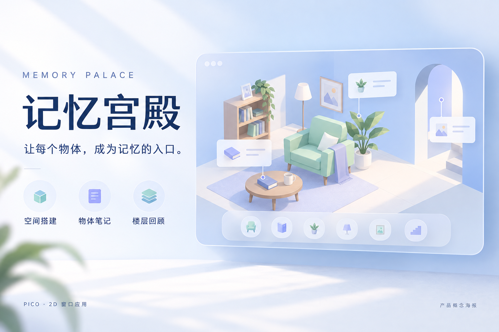

# 记忆宫殿 Memory Palace

在 PICO 的 2D 窗口中搭建属于自己的记忆空间，把知识和待办放到物体上，再沿着熟悉的空间线索回顾。



[下载 v1.0 APK](https://github.com/skyscraperlee22-del/memory-palace-2d/releases/tag/v1.0) · [20 项报名资料](docs/SUBMISSION.md) · [PICO 实际窗口截图](media/screenshot-pico-window.png) · [示例场景](media/screenshot-demo-floor.png) · [记录看板](media/screenshot-demo-overview.png) · [素材说明](media/README.md)

## 功能

- 创建、重命名和切换楼层，按不同主题组织空间。
- 从居家、办公、校园、商场、走廊分类中选择物体，进行摆放、移动、90° 旋转、锁定和删除。
- 给物体添加多条知识笔记或待办，填写日期与时间，让物体成为信息入口。
- 缩远进入当前楼层的 Memory overview，看板支持楼层切换与模型分类颜色筛选。
- 使用本机 localStorage 保存楼层、物体和笔记，重新打开后继续使用。

## 运行与技术

项目是已确认的 2D 窗口版。Android 宿主采用 Kotlin；页面使用 React、Three.js 和 WebSpatial，3D 模型为 GLB。网页内容随 APK 打包，默认从应用内 appassets 地址加载。

保留两个入口：

| 入口 | 作用 |
| --- | --- |
| `com.example.memorypalace.WebActivity` | 当前保留 APK 的默认启动入口，以 Android WebView 显示页面 |
| `com.example.memorypalace.platform.LaunchActivity` | SpatialUI `DefaultWindowContainer` / Planar WindowContainer 入口，使用 `AndroidView(WebView)` 承载同一页面 |

Spatial SDK BOM 为 0.13.3，Kotlin 为 2.0.0，AGP 为 8.13.2，Gradle 为 8.13。Android compile/target/min SDK 均为 35，ABI 为 arm64-v8a。版本号 1.0，versionCode 1。

2D 窗口直接加载随包网页与 GLB 资源，不使用模板中的 `editor-asset` 场景。该模板保留为历史参考，不参与 Gradle 构建；构建不再要求本机安装 Spatial Editor 或设置 `PICO_HOME`。

网页前端保留可运行的编译产物和独立 Overview 扩展。与该运行包准确对应的 React 原始源码尚未恢复，因此本仓库不把其他工程的前端源码当作此版本源码。Android 工程可独立构建。

## 构建

构建执行目录为此 GitHub 仓库的根目录（平台有该字段时填写 `.`）。此目录直接包含 `settings.gradle`、`build.gradle`、`gradlew`、`gradle/` 与 `app/`，无需再进入名为 `memory-palace-2d` 的子目录。

构建配置统一使用 Groovy `.gradle` 文件，以兼容仅检查传统 Gradle 文件名的打包平台。

安装 Android SDK 35 和 JDK 21，配置 `ANDROID_HOME` 与 `JAVA_HOME` 后，在仓库根目录运行：

```bash
./gradlew :app:assembleDebug
```

输出为 `app/build/outputs/apk/debug/app-debug.apk`。2026-10-16 已从不含 `local.properties` 和项目构建缓存的源码导出目录，在不设置 `PICO_HOME` 的情况下完成 Debug / Release 构建验证（使用已安装的 Android SDK 与依赖缓存），85 个任务执行成功；两个 APK 中的 104 个网页运行资源均与原版校验清单一致。首次构建会访问配置中的 PICO Maven 仓库。不要将本机 `local.properties`、签名密钥或用户数据提交到仓库。

旧配置包含未使用的 `editor-asset` 模板模块，加载 Spatial Tools 插件时会查找本机 Spatial Editor。已复现：缺少 `PICO_HOME` 及其他编辑器路径配置时，即使 Gradle 文件完整，也会报 `Spatial Tools is not installed`。当前配置已移除该模块的构建引用。平台的具体失败阶段仍应以其完整日志为准。

如果平台执行 Release 构建，使用 `./gradlew :app:assembleRelease`，输出为 `app/build/outputs/apk/release/app-release-unsigned.apk`；发布签名由打包平台配置。重新提交作品时请填写构建修复后的 Commit ID，旧的 v1.0 标签仍保留最初发布快照。

安装、启动保留版本：

```bash
pico-cli app install MemoryPalace-2D-v1.0-debug.apk --device <device-id>
pico-cli app launch com.example.memorypalace --activity .WebActivity --device <device-id>
```

包名与旧版相同；在已有用户数据的设备上安装前请保留用户数据备份，签名不一致时不要通过卸载解决。发布页 APK 为原版保留文件，SHA-256：

```text
c0613f1e23112118f6dc026ccbbe066dcfb133a957a4bc7e4f3ff1459da155d7
```

## 浏览器预览

```bash
python3 -m http.server 5186 --bind 127.0.0.1 --directory app/src/main/assets/memory-palace
```

打开 `http://127.0.0.1:5186/`。浏览器预览和设备 WebView 各自使用独立存储。截图用的合成示例见 `docs/demo-state.json`，不会随安装自动载入。

## 数据与资源

存储键为 `pico-spatial-builder-v3`。用户真实存档不在仓库或 APK 备份中。`docs/runtime-sha256.json` 用于核对本版页面和资源文件。APK 放在 Releases，源码仓库不包含构建缓存。

资源来自本项目已有运行包。Android、PICO SDK、React、Three.js、WebSpatial 等第三方内容受各自许可证与使用条款约束；本仓库未为全部内容声明统一的开源许可证。
